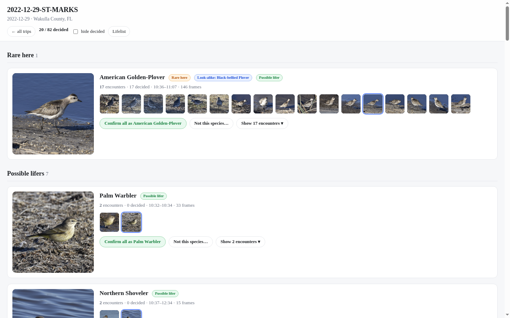
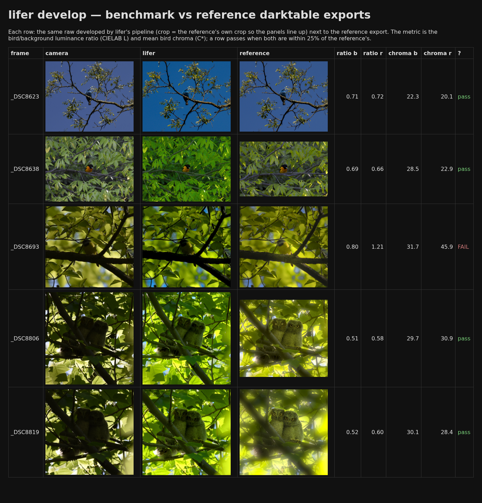
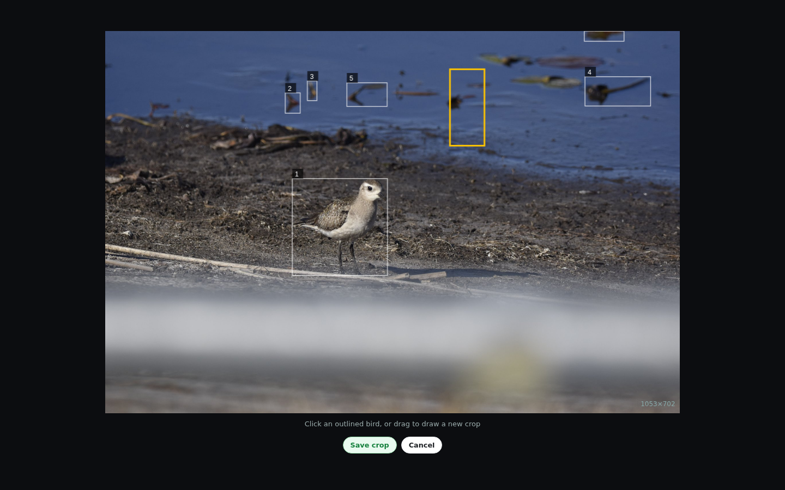

# lifer

lifer is a bird photo pipeline. Point it at a folder of raw photos from a
trip and it finds the birds in each frame, identifies candidate species,
groups frames into encounters, and lets you review everything in a local
web app. Confirmed birds feed a lifelist; the best frames can be developed
into final edits and published as a static site.

It is built for Nikon NEF raws (each NEF's embedded full-size JPEG is used,
no demosaicing) and runs entirely on your machine.

The trip review page, with species groups:



## How it works

For every `.NEF` in a folder:

1. **Detection** - a YOLO11m bird detector finds a bird box in the embedded
   JPEG (per-image, cached).
2. **Classification** - the bird crop is scored against every North American
   species (the iNaturalist Aves list, in IOC taxonomic order) with
   BioCLIP 2.5.
3. **Encounters** - frames are grouped into distinct encounters (same bird,
   consecutive frames).
4. **Regional prior** - species likelihoods are re-ranked against the
   species list for the trip's region (an iNaturalist place), so what is
   rare where you shot is flagged as rare.
5. **Outputs** - `candidates.csv` (all frames, top candidates),
   `top_candidates.csv` (best frame per encounter), and per-encounter best
   frames under `runs/<trip>/best/`.

Then you:

- **Review** - `lifer serve` opens a local web app: trips and species
  groups, encounters as cards, a lightbox where you confirm species, record
  counts, fix the crop box by hand, and attach notes. Decisions live in a
  local SQLite DB; re-runs keep your fixes.
- **Lifelist** - confirmed species roll up into `data/lifelist.csv`
  (species, first/latest dates, locations, counts).
- **Develop** (optional) - `lifer develop` runs darktable-cli on the chosen
  frames: a style template decoded from your own edited sidecars, global
  exposure metered on the bird box, a bird-local lift for back-lit birds,
  and a 4:5/3:2 crop around the detection. `--benchmark` compares the
  results against a set of reference exports.
- **Publish** (optional) - `lifer publish` writes a static site: a
  per-species page (clearest frame per encounter) plus a public lifelist
  page.

## Requirements

- Nix with flakes enabled
- an NVIDIA GPU with CUDA (the pipeline refuses to run without one)
- `darktable` and `exiftool` for the develop/publish steps (both are
  provided by the flake)

## Quickstart

```sh
# find birds in a folder of raws (the folder is read-only; outputs go to
# ~/.local/share/lifer)
nix run ~/path/to/lifer -- run /path/to/trip-folder

# review the results in the web app (http://127.0.0.1:8000)
nix run ~/path/to/lifer -- serve

# publish a static site
nix run ~/path/to/lifer -- publish /path/to/site-dir
```

`run` downloads the two model weights on first use (into `~/.cache/lifer`)
and caches all per-image work, so re-runs are cheap and partial.

## Develop

Develop learns its style from your own darktable-edited sidecars:

```sh
# summarise your develop style (writes ~/.local/share/lifer/style/style.json)
nix run . -- dt-style --source /path/to/folder-with-edited-sidecars

# develop the best frames of a trip
nix run . -- develop /path/to/trip-folder \
    --style-sidecar /path/to/one-edited-photo.NEF.xmp

# compare against a set of hand-made reference exports
nix run . -- develop /path/to/trip-folder --benchmark \
    --reference /path/to/reference-exports \
    --reference-sidecars /path/to/folder-with-sidecars \
    --style-sidecar /path/to/one-edited-photo.NEF.xmp
```

The develop benchmark compare page:



## Configuration

State lives in `LIFER_HOME` (env var, else `--home`, else
`~/.local/share/lifer`): `runs/` outputs, `cache/` per-image and API
caches, `data/` the lifelist and the decisions DB. Model weights live in
`~/.cache/lifer` (re-downloadable).

The one setting you will want to edit is the region map. A user copy at
`LIFER_HOME/regions.toml` overrides the one shipped with the package; it
maps folder-name globs to iNaturalist places:

```toml
# place_id from iNaturalist's place autocomplete (inaturalist.org/places)
[[region]]
glob = "*ST-MARKS*"
name = "Wakulla County, FL"
short_name = "Wakulla Co."
place_id = 1317
```

Everything else (detection size and threshold, BioCLIP temperature,
top-k, encounter grouping) has a sensible default and is exposed as a flag
on `run`.

## home-manager (optional)

To keep the review app running as a service:

```nix
home-manager.users.you.modules = [ (fetchTarball "github:ewtodd/lifer") ];
```

The module installs `lifer` (with darktable and exiftool on PATH) and a
`lifer-serve` systemd service bound to 127.0.0.1.

## Privacy

lifer runs locally. The only network traffic is the public iNaturalist API
(no API key) for the region species lists, plus the one-time model weight
downloads. Your photos are never uploaded anywhere.

## The review app

The lightbox with fix-crop (click an outlined bird, or drag to draw a new
crop):



## Credits and licenses

- lifer itself: MIT (see LICENSE)
- BioCLIP 2.5 (ViT-H/14) by the Imageomics Institute (MIT), fine-tuned from
  OpenCLIP ViT-H/14; weights `imageomics/bioclip-2.5-vith14`, loaded with open_clip
- YOLO11m (COCO pretrained) by Ultralytics (AGPL-3.0). lifer's own code is MIT,
  but anything that redistributes it together with Ultralytics falls under the AGPL
- darktable (develop step), iNaturalist (species lists)

## Maintenance

If you ran the pre-release version of this project (back when it was named
`birdid`), `lifer migrate` moves your existing state to the current layout.
`scripts/ioc_order.py` regenerates the IOC-ordered species list used for
classification.
